<p align="center">
  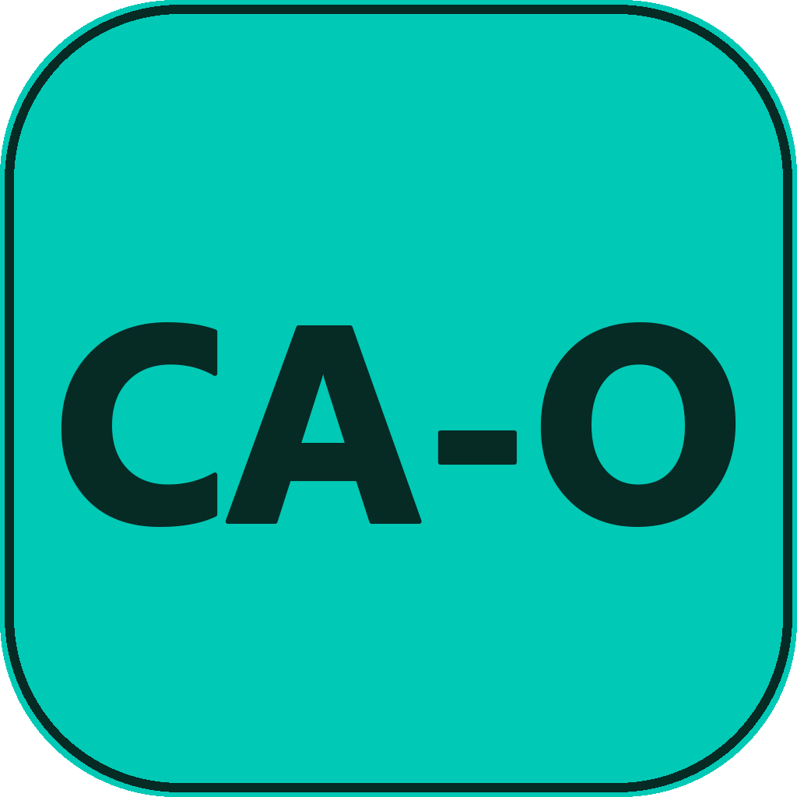
</p>

<h1 align="center">CA-O</h1>

<p align="center">
  <b>Plataforma nativa de rendimiento, diagnóstico y optimización para Windows 11</b><br>
  Diagnostica primero · recomienda con evidencia · aplica en transacción · revierte si falla
</p>

<p align="center">
  <a href="https://github.com/Pyromesis/CA-O/releases/latest/download/CA-O.Setup.exe"></a>
  <a href="https://github.com/Pyromesis/CA-O/releases"></a>
  <a href="#licencia"></a>
</p>

<p align="center">
  <a href="#descarga"><b>Descarga</b></a> ·
  <a href="#capturas"><b>Capturas</b></a> ·
  <a href="#como-funciona"><b>Cómo funciona</b></a> ·
  <a href="#seguridad"><b>Seguridad</b></a> ·
  <a href="#catalogo"><b>Catálogo</b></a> ·
  <a href="#compilar"><b>Compilar</b></a>
</p>

<p align="center">
  <a href="https://www.microsoft.com/windows"></a>
  <a href="global.json"></a>
  <a href="https://microsoft.github.io/microsoft-ui-xaml/"></a>
  <a href="https://github.com/Pyromesis/CA-O/releases/tag/v2.2.21"></a>
  <a href="#pruebas"></a>
  <a href="#pruebas"></a>
</p>

<p align="center">
  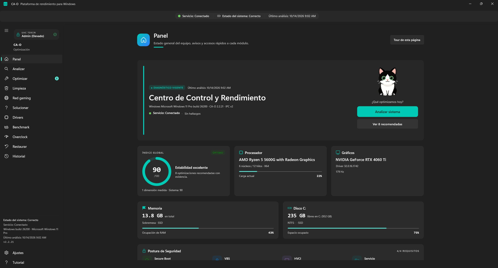
</p>

---

## Qué es CA-O

Una aplicación **100 % nativa** para Windows, escrita en **.NET 10 + WinUI 3**. No es una lista de tweaks: **mide** hardware, térmicas, red, almacenamiento, drivers y postura de seguridad **antes** de recomendar. Cada cambio se ejecuta en una transacción con **snapshot previo, verificación y rollback automático**.

| | | | |
|:---:|:---:|:---:|:---:|
| **122**<br>optimizaciones transaccionales | **13**<br>páginas nativas | **2.582**<br>tests en verde | **0**<br>telemetría externa |

**La pregunta que guía el diseño:** *¿cuál es la mejor configuración para ESTE Windows, ESTE hardware, ESTE driver, ESTE juego y ESTE objetivo?* — no *¿qué tweaks tiene Internet?*

| Pilar | Qué significa en la práctica |
|---|---|
| **Diagnose** | Proveedores WMI/Registry en paralelo con timeout de 5 s. Si un dato falta, se muestra «no disponible»; nunca se inventa |
| **Optimize** | `RecommendationEngine` asigna **un bucket** por optimización consultando el contexto real del equipo |
| **Benchmark** | Mediana de trials y suelo de ruido del **3 %**. Veredictos: *Mejora medible*, *Sin mejora* o *Regresión*. No se simulan FPS |
| **Recover** | Snapshot antes de mutar, journal por transacción, hash-chain en el historial y verificación post-reversión |
| **Overclock** | Catálogo declarativo de knobs, búsqueda por bisección y delta **no aditivo** (nunca se atribuye el total a un solo ajuste) |

---

<a id="como-funciona"></a>

## Cómo funciona

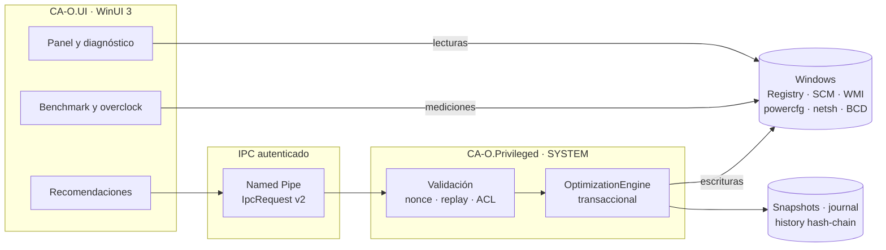

- La UI **siempre eleva** (`requireAdministrator`), pero **toda escritura cruza el pipe** hacia el servicio `SYSTEM`: privilegio mínimo y auditado.
- Sin servicio, la app funciona en **modo solo lectura**: diagnóstico y benchmark sí; optimizar no.
- El servicio arranca como `delayed-auto`; si la app lo encuentra detenido, intenta levantarlo y, si no existe, se reinstala desde **Ajustes → Instalar ahora**.

### Una optimización, paso a paso

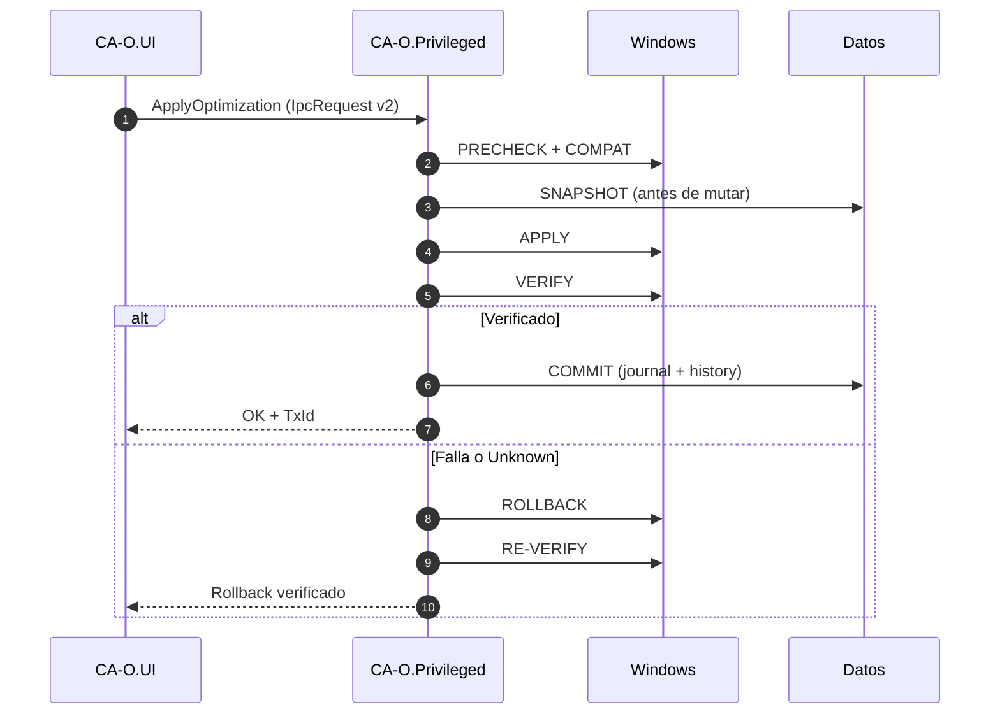

- Un lote aplica **secuencialmente** y se detiene en el primer fallo, revirtiendo lo ya aplicado cuando el riesgo es `Safe`/`Low`.
- La cancelación solo es posible **antes** de `SNAPSHOT`/`APPLY`; durante `APPLY` la operación es atómica.
- `VerifyAsync` distingue `Passed`, `Failed`, `Unknown` y `NotApplicable`. **`Unknown` nunca se considera éxito**.

---

<a id="seguridad"></a>

## Seguridad por diseño

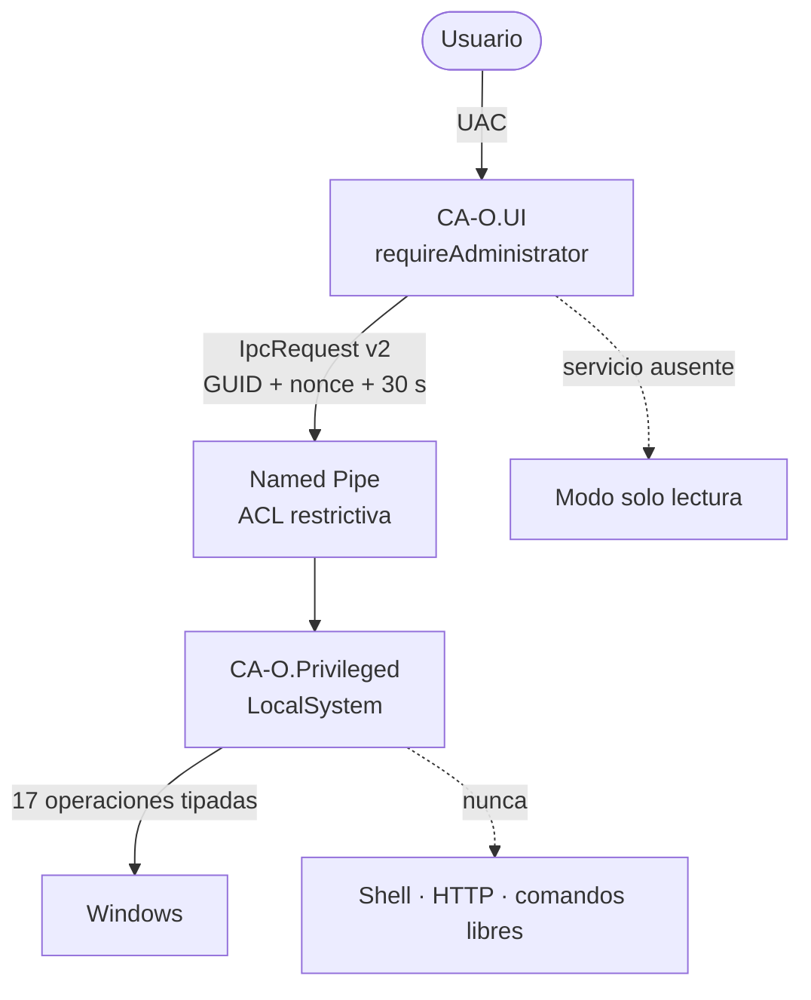

| Superficie | Control |
|---|---|
| **Canal** | Named Pipe con ACL (`SYSTEM`, `Administrators`, `Interactive`), identidad del cliente por `RunAsClient()` y `SessionId` |
| **Petición** | Protocolo v2, `RequestId` GUID, nonce de 16–128 caracteres, frescura de ±30 s y tamaño máximo de 64 KB |
| **Replay** | `ReplayCache` de un solo uso con TTL de 30 s y aceptación atómica |
| **Operaciones** | Allowlist de **17 operaciones tipadas**. No existe «ejecutar comando» |
| **Ejecución** | `CommandPolicy` con rutas absolutas de `%SystemRoot%\System32`, 58 claves y cero metacaracteres; sin PowerShell en el path de ejecución |
| **Integridad** | Snapshots con SHA-256, journal por `txid` e historial encadenado por hash |

> `disable-vbs` y los ajustes sensibles se **bloquean** (`CAO-GAME-001`) si se detecta Vanguard, EAC o BattlEye. `ExpertMode` no salta ese bloqueo.

Detalle completo en [SECURITY.md](docs/SECURITY.md) y [THREAT-MODEL.md](docs/THREAT-MODEL.md).

---

<a id="capturas"></a>

## Capturas

> Capturas reales de **CA-O 2.2.21** en Windows 11 a 2560×1440, sin IPs, usuarios ni datos de red personales.

| Analizar | Optimizar |
|:---:|:---:|
| 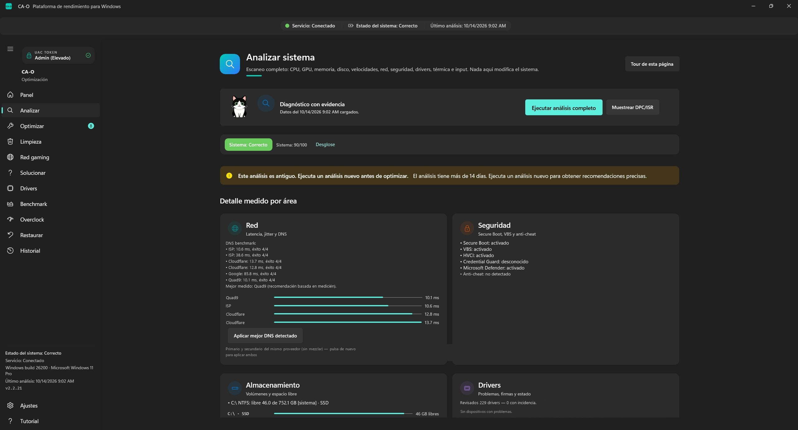 | 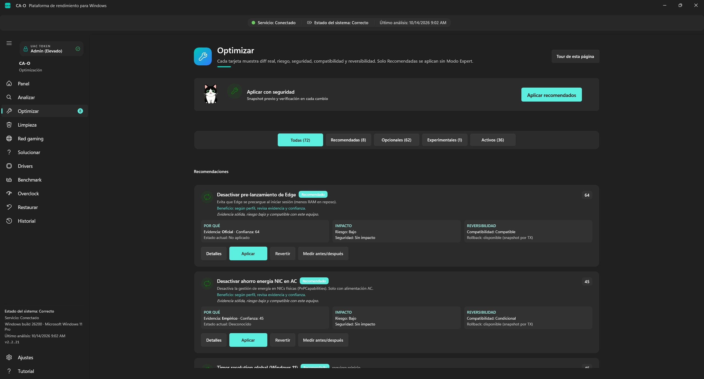 |
| Salud 0–100 por dimensión, hallazgos y DNS medido | Buckets, diff Before/After y lote de recomendadas |

| Limpieza | Red gaming |
|:---:|:---:|
| 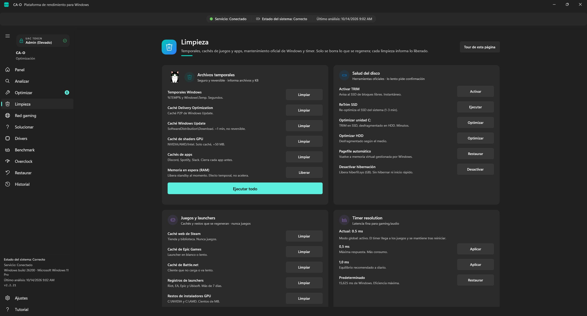 | 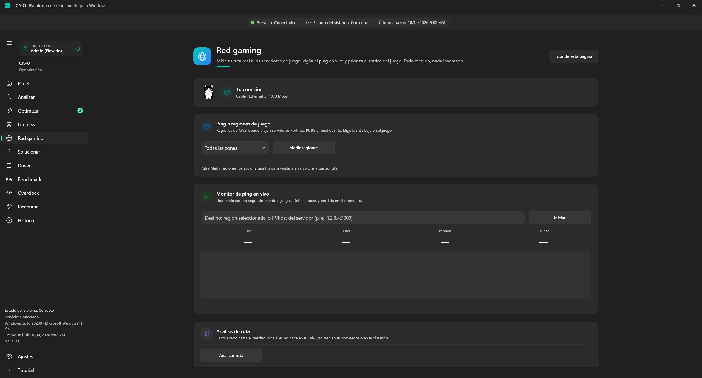 |
| Temporales, cachés, DNS y timer de 0,5/1,0 ms | Ping, jitter y pérdida a 21 regiones en tiempo real |

| Solucionar | Drivers |
|:---:|:---:|
| 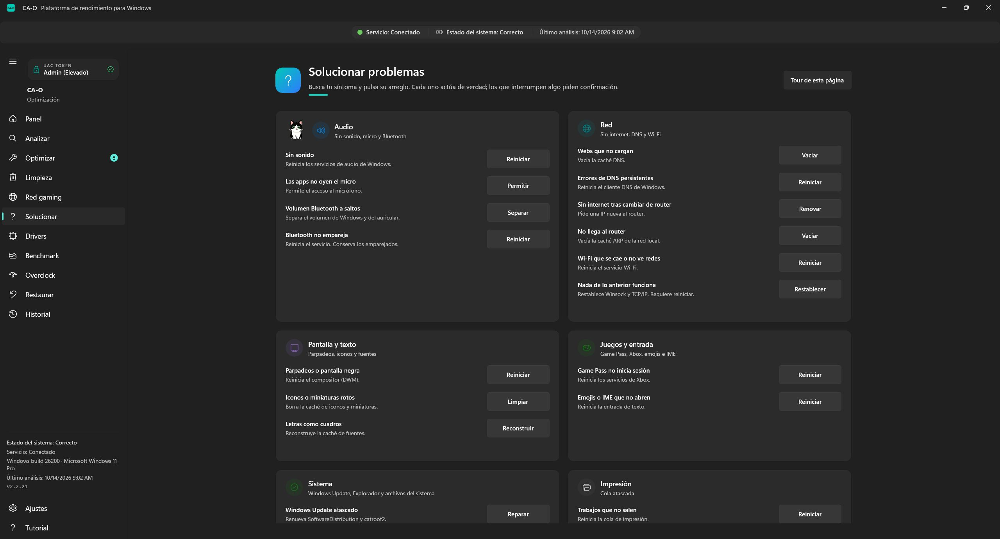 | 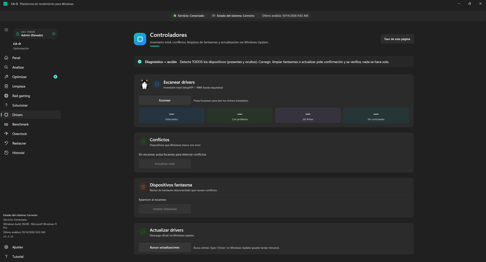 |
| Reparaciones directas con efecto real | Inventario WMI, conflictos y `pnputil` por dispositivo |

| Benchmark | Overclock |
|:---:|:---:|
| 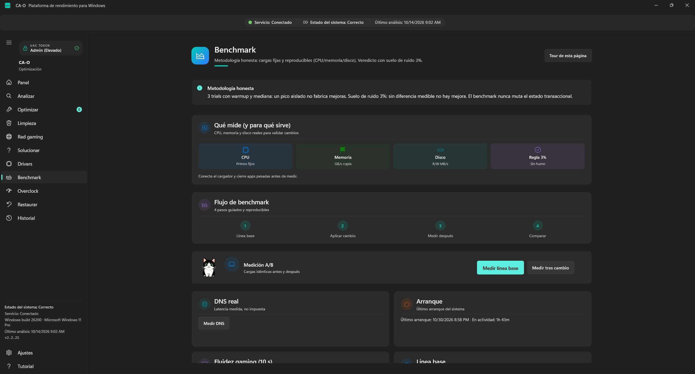 | 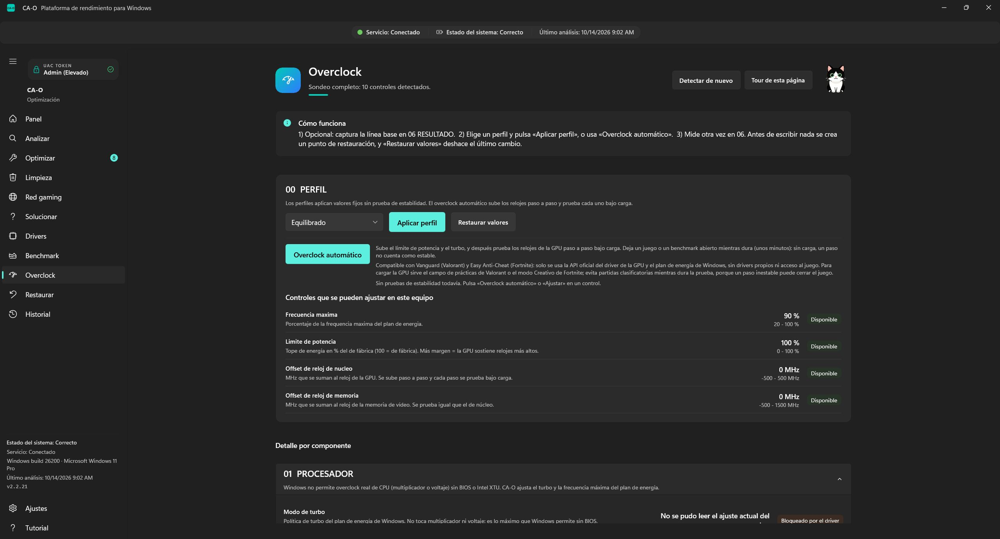 |
| Línea base → aplicar → medir → veredicto | Tuning real por vendor con recovery D4 y anti-cheat |

| Restaurar | Historial |
|:---:|:---:|
| 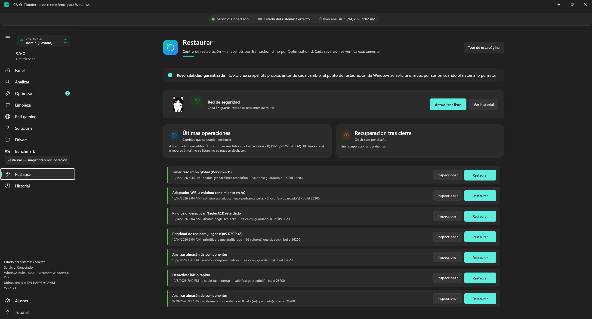 | 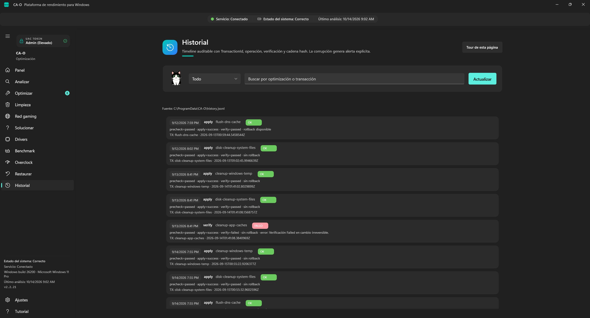 |
| Snapshot por `TxId` y reversión verificada | Timeline auditable e integridad del hash-chain |

| Ajustes | Tutorial |
|:---:|:---:|
| 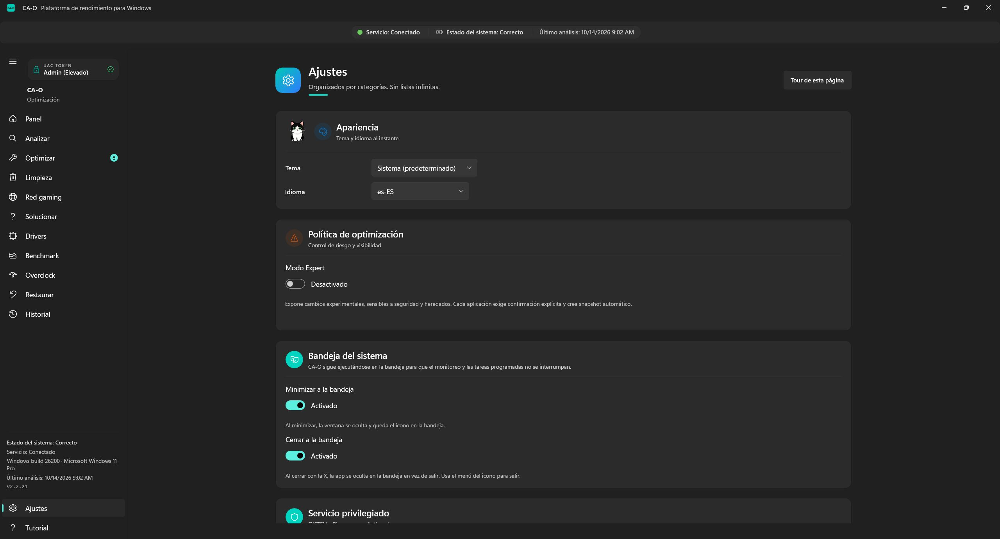 | 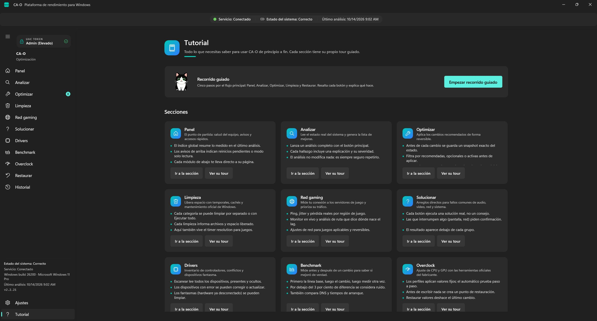 |
| Tema, idioma, `ExpertMode`, servicio y auto-update | Tour guiado por la app y ayuda contextual |

---

## Páginas

| Página | Qué hace |
|---|---|
| **Panel** | Salud global, CPU/GPU/RAM/disco, estado del servicio y próximo paso |
| **Analizar** | Análisis paralelo, salud 0–100 por dimensión, hallazgos, DPC/ISR y benchmark DNS |
| **Optimizar** | Tarjetas con bucket, evidencia, riesgo, compatibilidad y diff Before/After |
| **Limpieza** | Temporales por optimización, papelera, DNS y timer resolution vía IPC |
| **Red gaming** | Ping/jitter/pérdida a 21 regiones, monitor 1 Hz, traceroute con diagnóstico y QoS |
| **Solucionar** | Audio, Bluetooth, vídeo, Windows Update, reloj, impresión y Explorador |
| **Drivers** | Inventario WMI, conflictos, `pnputil` por dispositivo y originales del fabricante |
| **Benchmark** | Flujo guiado de 5 pasos con mediana y suelo de ruido del 3 % |
| **Overclock** | 6 secciones, tuning real por vendor, recovery D4 y puerta anti-cheat |
| **Restaurar** | Snapshots por `TransactionId`, integridad SHA-256 y reversión verificada |
| **Historial** | Timeline de `history.jsonl`, filtros y verificación del hash-chain |
| **Ajustes** | Tema, idioma, `ExpertMode`, servicio privilegiado, updates y bandeja |
| **Tutorial** | Tour guiado por la app y capítulos de ayuda |

---

<a id="catalogo"></a>

## Catálogo

**122 optimizaciones en producción** + 13 retiradas que permanecen en `AllLegacy` solo para trazabilidad. Cada entrada declara qué cambia, por qué, con qué evidencia, qué riesgo y seguridad afecta, si es reversible y cómo se verifica.

| Área | Ejemplos |
|---|---|
| **Performance** | Efectos visuales, transparencia, indexado, menú, timer, prioridad de primer plano |
| **Gaming** | Game Mode, HAGS, VRR, MMCSS, cola de ratón, precisión 1:1, QoS de juegos |
| **Red** | TCP/UDP, RSS, Nagle, DNS, Wi-Fi, RSC, EEE, roaming y ancho de banda de Windows Update |
| **Almacenamiento** | TRIM, defrag, hibernación, WinSxS, temporales y cachés de apps/juegos |
| **Energía** | Planes, USB/PCIe, Wi-Fi en AC y limpieza de planes huérfanos |
| **Privacidad** | Telemetría, Copilot, widgets, sugerencias y arranque de OneDrive |
| **Arranque** | Apps, servicios y tareas de terceros clasificados por impacto |
| **Sistema** | Punto de restauración, reboot pendiente y auditoría de recuperación |
| **Solucionar** | Audio, BT, compositor, Windows Update, reloj, impresión, Search y Explorador |

**Proyecciones honestas:** 86 en el lote por defecto (`BatchDefault`), 23 reparaciones (`RepairActions`), 4 diagnósticos de solo lectura (`Diagnostics`) y 9 restauraciones (`Restores`). Es una proyección, no un borrado: `All` sigue teniendo 122 y todo ID resuelve.

📖 [Catálogo completo, con evidencia, riesgo y flags](docs/OPTIMIZATION-CATALOG.md)

### Perfiles

| Perfil | Enfoque | Expert |
|---|---|:---:|
| **Safe** | Solo `Recommended` con riesgo `Safe`/`Low` | No |
| **Balanced** | `Recommended` + `Optional` seguros | No |
| **Gaming** | FPS y latencia, respetando anti-cheat | No |
| **Competitive** | Máximo gaming; permite ajustes `Low` de energía/red | No |
| **Privacy** | Privacidad y arranque | No |
| **Security** | Solo hardening reversible | No |
| **Maintenance** | Almacenamiento, sistema y reboot | No |
| **Expert** | Expone `Experimental` y `SecuritySensitive` | **Sí** |
| **Custom** | El usuario elige | — |

Ningún perfil es una lista fija: se calculan contra el `SystemContext` real. `Expert` exige confirmación y snapshot, y **no bypassa** los bloqueos críticos.

---

## Stack

| Capa | Tecnología |
|---|---|
| **Runtime** | .NET SDK **10.0.400** (`rollForward: latestFeature`) |
| **UI** | WinUI 3 / Windows App SDK **2.4.0**, Mica y `NavigationView`, sin MSIX obligatorio |
| **MVVM / DI** | CommunityToolkit.Mvvm **8.4.0** + Microsoft.Extensions.DependencyInjection **10.0.0** |
| **Datos** | WMI, Registry API, SCM, `powercfg`, `netsh`, BCD y `fsutil` |
| **Servicio** | `CA-O.Privileged` como `BackgroundService` en `LocalSystem` |
| **Pruebas** | xUnit **2.9.2** · 2.582 tests en 6 suites |
| **CI** | CodeQL + `dotnet audit` + Dependabot + SBOM CycloneDX |

Los artefactos de release son **self-contained**: no requieren runtime instalado.

---

## Requisitos

| | |
|---|---|
| **SO** | Windows 10 1809 (17763) o superior, **x64**. Probado en Windows 11 22H2+ |
| **Permisos** | Cuenta de administrador con UAC. El servicio corre como `LocalSystem` |
| **Hardware** | 4 GB de RAM, 700 MB de disco y resolución mínima de 1280×720 |
| **Desarrollo** | .NET SDK 10.0.400 + Windows 10 SDK 10.0.19041 + VS 2022 17.8 o `dotnet` CLI |

---

<a id="descarga"></a>

## Instalación

| Opción | Archivo | Qué hace |
|---|---|---|
| **A · Recomendada** | [CA-O.Setup.exe](https://github.com/Pyromesis/CA-O/releases/latest/download/CA-O.Setup.exe) | Un solo exe: descarga el paquete y abre el instalador gráfico |
| **B · Offline** | [CA-O-Setup-GUI-x64.zip](https://github.com/Pyromesis/CA-O/releases/latest/download/CA-O-Setup-GUI-x64.zip) | Paquete completo (88 MB). Verifica el hash con `SHA256SUMS.txt` |
| **C · Clásica** | [CA-O-Instalador.exe](https://github.com/Pyromesis/CA-O/releases/latest/download/CA-O-Instalador.exe) | Instalador Inno Setup con app, servicio y atajos |
| **D · Portable** | `ui/CA-O.UI.exe` | Sin servicio: diagnóstico y benchmark, **modo solo lectura** |

El instalador pide UAC, copia la app a `C:\Program Files\CA-O`, registra el servicio con recuperación automática y crea los atajos. Log: `%TEMP%\CA-O-Setup-Gui.log`.

<details>
<summary><b>Instalación manual del servicio</b></summary>

```powershell
# PowerShell como administrador
powershell -ExecutionPolicy Bypass -File scripts/install-privileged-service.ps1
sc.exe start CAO.Privileged
sc.exe query CAO.Privileged    # STATE: 4 RUNNING
sc.exe qc CAO.Privileged       # START_TYPE: DEMAND_START
```

También puedes usar **Ajustes → Servicio privilegiado → Instalar ahora**: repara el servicio sin necesidad del repositorio.

</details>

**Desinstalación:** `C:\Program Files\CA-O\uninstall\CA-O.Uninstaller.exe` (elevado) o Panel de control → Programas y características → CA-O. Detiene y elimina el servicio, los atajos y la entrada ARP.

---

<a id="compilar"></a>

## Desarrollo

```powershell
dotnet restore CA-O.sln
dotnet build CA-O.sln -c Debug
dotnet run --project src/CA-O.UI --configuration Debug

powershell -ExecutionPolicy Bypass -File scripts/verify.ps1        # 5 gates
powershell -ExecutionPolicy Bypass -File scripts/build-release.ps1 # release + SBOM
powershell -ExecutionPolicy Bypass -File scripts/package.ps1       # ZIP + SHA-256
```

- **Firma Authenticode:** define `CAO_SIGN_THUMBPRINT`; `scripts/sign.ps1` firma `ui/*.exe` y `service/*.exe` con timestamp. Sin certificado, el updater valida el **SHA-256** del ZIP contra el sidecar del release.
- **Versionado:** una sola fuente en `Version.props`; el bump se propaga a todos los `csproj` y a `AppVersion`.
- **Empaquetado:** `artifacts/release/` (ui, service, gui-installer, uninstall, setup) + `SHA256SUMS.txt` + `bom.json`.

---

## Pruebas

| Suite | Cubre | Tests |
|---|---|:---:|
| `CA-O.Core.Tests` | Catálogo, transacciones, scoring, health, gaming, overclock | **1527** |
| `CA-O.Security.Tests` | IPC, replay, `CommandPolicy`, identidad y flood | **274** |
| `CA-O.Infrastructure.Tests` | Historial, snapshots, WMI, DNS y backends de overclock | **220** |
| `CA-O.UI.Tests` | ViewModels, localización, updater, tours y mascota | **484** |
| `CA-O.Integration.Tests` | E2E, recuperación de journal, capas y docs↔código | **60** |
| `CA-O.Benchmark.Tests` | Mediana, trials y suelo de ruido del 3 % | **17** |
| **Total** | **6 suites en Release** | **2582** |

```powershell
powershell -ExecutionPolicy Bypass -File scripts/test.ps1
dotnet test CA-O.sln -c Release
dotnet test --filter "FullyQualifiedName~GameCompatibility"
```

---

## Datos y privacidad

<details>
<summary><b>Rutas de persistencia</b></summary>

| Ruta | Contenido |
|---|---|
| `%ProgramData%\CA-O\analysis-state.json` | Último análisis (schema v2, escritura atómica, cuarentena si está corrupto) |
| `%ProgramData%\CA-O\history.jsonl` | Historial encadenado por SHA-256 |
| `%ProgramData%\CA-O\snapshots\{txid}\` | Snapshot + manifiesto + `integrity.json` |
| `%ProgramData%\CA-O\transactions\{txid}.jsonl` | Journal de fases para crash recovery |
| `%AppData%\CA-O\settings.json` | Tema, idioma, `ExpertMode` y estado de UI |
| `%LOCALAPPDATA%\CA-O\logs\` | `cao-ui-structured.log` (JSON) y `cao-ui-crash.log` |

Las ACL de `%ProgramData%\CA-O` se endurecen con `scripts/harden-data-acls.ps1` (`SYSTEM F`, `Administrators M`, `Users RX`).

</details>

**Sin telemetría, sin analytics y sin secretos.** Solo se hacen sondas de red explícitas (ping/DNS) cuando el usuario las pide.

---

## Solución de problemas

<details>
<summary><b>Problemas frecuentes</b></summary>

| Síntoma | Causa | Solución |
|---|---|---|
| **La app no abre** | Falta Windows App SDK o se ejecutó sin admin | Revisa `cao-ui-crash.log`, usa el ZIP completo y **Ejecutar como administrador** |
| **Servicio no disponible** (`CAO-IPC-007/008`) | Servicio detenido o no instalado | `sc.exe start CAO.Privileged` o **Ajustes → Instalar ahora** |
| **Servicio perdido tras reiniciar** | Arranque `delayed-auto` | Es normal: la app lo levanta al abrir; también puedes hacerlo desde Ajustes |
| **Access denied al arrancar el servicio** | Falta elevación | Ejecuta la consola como administrador |
| **Análisis «no disponible»** | WMI bloqueado o timeout | Revisa `cao-ui-structured.log`; los providers marcan warning, no crashean |
| **Optimización `BLOCKED CAO-GAME-001`** | Anti-cheat detectado | Es intencional. Usa el perfil `Balanced` o retira el anti-cheat |
| **El snapshot no revierte** | Optimización `NotReversible` | Se audita como `NotApplicable`; no hay reversión exacta (defrag, DISM ResetBase) |
| **Historial con `corruptedCount`** | Líneas corruptas en `history.jsonl` | `ReadLast` las salta y se muestra un aviso; no hay crash |
| **Error 404 al instalar** | Asset movido o URL obsoleta | Usa el ZIP offline o `CA-O.Setup.exe` |

</details>

---

## Documentación

| Documento | Contenido |
|---|---|
| [Arquitectura](docs/ARCHITECTURE.md) | Procesos, capas, motores, ciclo transaccional y persistencia |
| [Seguridad](docs/SECURITY.md) | IPC, autorización, ejecución y cadena de suministro |
| [Modelo de amenazas](docs/THREAT-MODEL.md) | STRIDE, trust boundaries y riesgos residuales |
| [Catálogo](docs/OPTIMIZATION-CATALOG.md) | 122 optimizaciones con evidencia, riesgo y flags |
| [Protocolo IPC](docs/IPC_PROTOCOL.md) | Envelope v2, payloads y cadena de validación |
| [Transacciones](docs/TRANSACTIONS.md) | Fases, estados del journal y recuperación |
| [Contribuir](CONTRIBUTING.md) · [Changelog](CHANGELOG.md) | Flujo de trabajo y cambios por versión |

---

## Reportar un error

Escríbenos a **ca.next.project@gmail.com** con:

- Versión de CA-O (`Ajustes → Sobre CA-O`) y build de Windows (`winver`).
- Qué hacías y pasos para reproducirlo.
- Captura de pantalla si aplica.
- Logs de `%LOCALAPPDATA%\CA-O\logs\` (`cao-ui-structured.log` y `cao-ui-crash.log`).

## Contribuir

Rama `feature/*` desde `main`, tests que fallen sin el parche y `scripts/verify.ps1` en verde. Toda optimización nueva implementa `IOptimization` con `Definition` completa, reversibilidad exacta y `PreviewAsync`; si usa un comando externo, necesita su patrón en `CommandPolicy` y un test anti-inyección. Consulta [CONTRIBUTING.md](CONTRIBUTING.md).

## Licencia

Copyright (c) 2026 CA-NEXT-PROJECT. Todos los derechos reservados.

Proyecto privado: no se concede licencia de uso, copia, modificación ni distribución sin autorización expresa y escrita del titular. El instalador muestra el contrato (EULA) y continuar supone su aceptación.

[LICENSE](LICENSE) · [PRIVACY.md](PRIVACY.md) · [THIRD-PARTY-NOTICES.md](THIRD-PARTY-NOTICES.md)

---

<p align="center"><i>CA-O 2.2.21 — Diagnóstico primero, evidencia después, transacción siempre.<br>Sin promesas, solo hechos medibles.</i></p>
